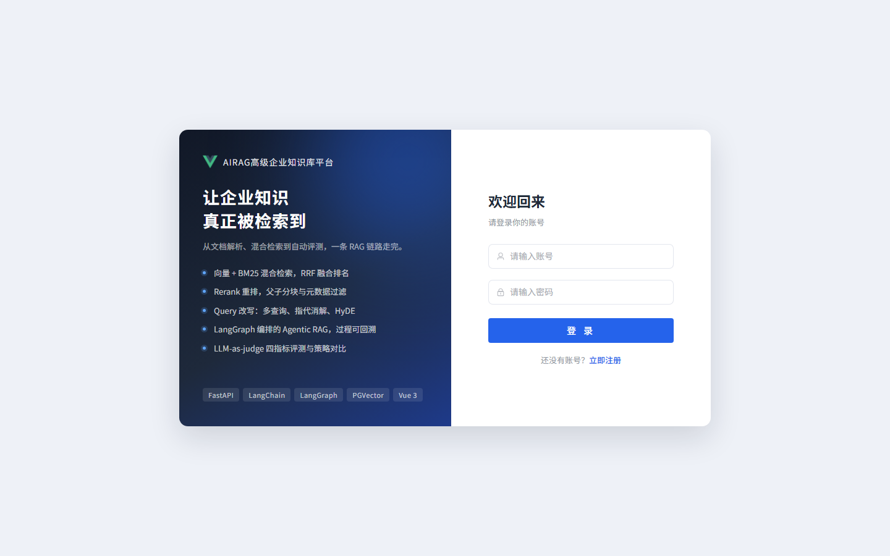
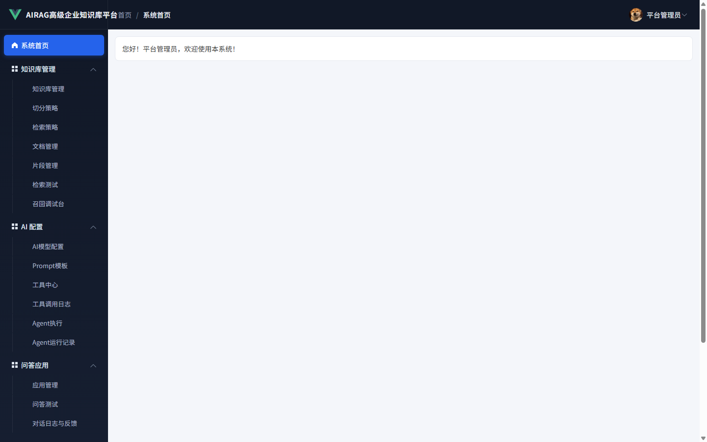
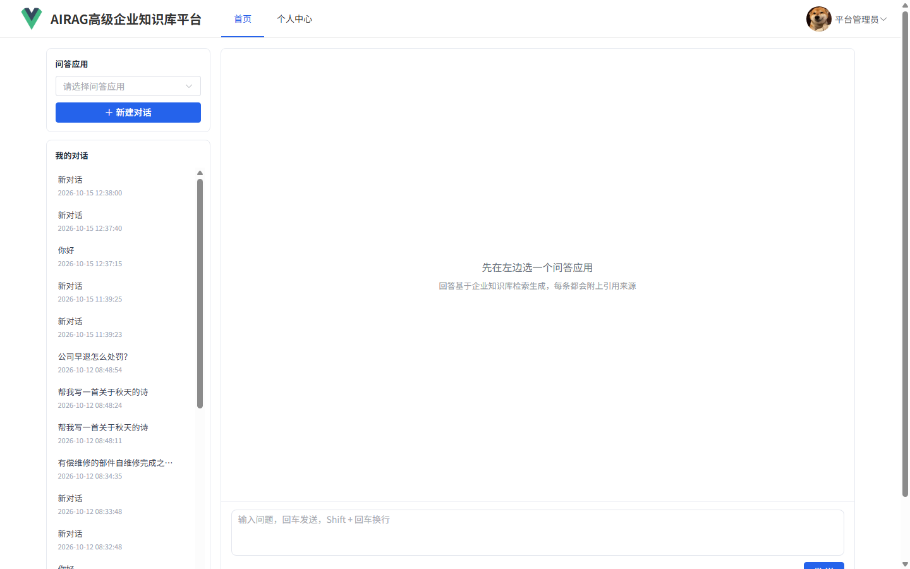

# AIRAG 高级企业知识库平台

一个可直接部署的企业级 RAG 知识库问答平台：把制度、产品手册、售后政策等文档导入知识库，通过**混合检索 + 重排 + 大模型生成**，返回有依据、带引用来源的答案。

管理端负责知识库、文档、片段、模型、Agent、评测与会话管理；用户端只保留一个简洁的智能问答窗口。







## 一键上网

Windows 上双击或右键运行：

```text
deploy\一键上网.ps1
```

脚本会自动完成：

1. 检查并启动本机 MySQL、PostgreSQL；
2. 首次运行时创建 Python 虚拟环境并安装后端依赖；
3. 首次运行时安装前端依赖并构建生产页面；
4. 启动后端，由后端同时托管前端和管理端；
5. 建立 Cloudflare 公网隧道，自动打开网址；
6. 把最新公网地址保存到 `deploy\公网地址.txt`。

运行成功后会输出两个入口：

- 用户端：`<公网地址>/front/home`
- 管理端：`<公网地址>/manager/home`

> Cloudflare Quick Tunnel 地址是临时地址，不需要服务器，也不需要注册账号。电脑关机、断网或隧道进程重启后地址会变化；重新运行一键脚本即可生成新地址。若需要永久域名，应改用 Cloudflare 命名隧道或云服务器部署。

### 使用前提

- Windows 10/11
- Python 3.12
- Node.js 18+
- MySQL 8（默认 `localhost:3306`，库名 `ai_rag`）
- PostgreSQL + pgvector（默认 `localhost:5432`，库名 `ai_rag_vector`）
- 首次运行需要联网下载依赖

## 核心能力

| 模块 | 能力 |
| --- | --- |
| 知识库管理 | 知识库、文档、片段三级维护，支持文本修正和批量删除 |
| 文档解析 | PDF、Word、Excel、Markdown、TXT，扫描件支持 OCR |
| 切分策略 | 固定长度、按标题、父子分块等策略 |
| 向量化 | 向量模型批量生成 1024 维向量并写入 PostgreSQL / PGVector |
| 混合检索 | 向量检索 + BM25 关键词检索，通过 RRF 融合 |
| 重排 | `gte-rerank-v2` 对召回片段二次排序 |
| 问句改写 | 指代消解、多路改写，改善多轮追问效果 |
| Agent | 基于 LangGraph 编排知识检索与函数工具 |
| 问答应用 | 知识库 + 检索策略 + 模型 + 提示词的组合配置 |
| 效果评测 | 评测集、批量评测、LLM-as-judge 评分、报告对比 |
| 反馈闭环 | 点赞点踩，点踩问题沉淀为新的评测用例 |

## 技术架构

- **后端**：Python 3.12、FastAPI、Tortoise ORM、MySQL 8、PostgreSQL + PGVector、LangChain / LangGraph
- **前端**：Vue 3、Vite 5、Element Plus、Vue Router、Axios、ECharts
- **模型**：阿里云百炼 `qwen-plus`、`text-embedding-v4`、`gte-rerank-v2`
- **公网入口**：Cloudflare Quick Tunnel；生产页面和后端统一由 `9090` 端口提供

```text
请求流程：
浏览器 -> FastAPI 9090 -> MySQL（业务数据）
                       -> PostgreSQL/PGVector（向量检索）
                       -> 百炼模型（改写、向量、重排、生成）
                       -> SSE 流式返回答案与引用
```

## 目录结构

```text
D:\RAG高级企业知识库平台\
├── RAG高级企业知识库平台\
│   ├── ai_rag\
│   │   ├── fastapi-app\        后端服务
│   │   └── vue\                前端工程（dist 为生产构建产物）
│   ├── ai_rag.sql              MySQL 业务库脚本
│   └── ai_rag_vector.sql       PostgreSQL / PGVector 脚本
├── deploy\
│   ├── 一键上网.ps1
│   ├── 公网地址.txt            首次上线后自动生成
│   └── logs\                   运行日志
├── 截图-登录页.png
├── 截图-管理后台首页.png
└── 截图-用户端智能问答.png
```

## 手动启动

### 1. 导入数据库

```sql
CREATE DATABASE ai_rag DEFAULT CHARACTER SET utf8mb4;
CREATE DATABASE ai_rag_vector;
```

```powershell
mysql -u root -p ai_rag < .\RAG高级企业知识库平台\ai_rag.sql
psql -U postgres -d ai_rag_vector -f .\RAG高级企业知识库平台\ai_rag_vector.sql
```

> `ai_rag_vector.sql` 已包含 pgvector 扩展、向量表、110 条示例向量和索引。向量维度为 1024，必须与启用的向量模型输出维度一致。

### 2. 数据库配置

打开 `RAG高级企业知识库平台\ai_rag\fastapi-app\settings.py`，按本机实际账号修改 MySQL 和 PostgreSQL 连接信息。也可以使用环境变量覆盖：

```powershell
$env:MYSQL_HOST="localhost"
$env:MYSQL_PORT="3306"
$env:MYSQL_DATABASE="ai_rag"
$env:MYSQL_USER="root"
$env:MYSQL_PASSWORD="你的密码"
$env:PGVECTOR_HOST="localhost"
$env:PGVECTOR_PORT="5432"
$env:PGVECTOR_DATABASE="ai_rag_vector"
$env:PGVECTOR_USER="postgres"
$env:PGVECTOR_PASSWORD="你的密码"
$env:JWT_SECRET="请替换为随机长字符串"
```

### 3. 启动后端

```powershell
cd .\RAG高级企业知识库平台\ai_rag\fastapi-app
python -m venv .venv
.\.venv\Scripts\Activate.ps1
pip install -r requirements.txt
python -m uvicorn main:app --host 127.0.0.1 --port 9090 --loop main:loop_factory
```

### 4. 构建并访问前端

```powershell
cd ..\vue
npm install
npm run build
```

生产构建完成后，直接访问：

- 用户端：`http://127.0.0.1:9090/front/home`
- 管理端：`http://127.0.0.1:9090/manager/home`
- API 文档：`http://127.0.0.1:9090/docs`

前后端开发模式仍可分别运行：后端 `9090`，前端 `npm run dev` 后访问 `http://localhost:5173`。

## 模型配置

进入管理端 → AI 模型配置，分别启用并填写：

| 类型 | 默认模型 | 默认地址 |
| --- | --- | --- |
| 对话模型 | `qwen-plus` | `https://dashscope.aliyuncs.com/compatible-mode/v1` |
| 向量模型 | `text-embedding-v4` | `https://dashscope.aliyuncs.com/compatible-mode/v1` |
| 重排模型 | `gte-rerank-v2` | `https://dashscope.aliyuncs.com/api/v1` |

三类配置均可使用“测试连接”按钮验证地址、密钥、模型名和向量维度。API Key 只保存在本机数据库，不应写入代码或提交到 GitHub。

## 演示账号

| 账号 | 角色 | 说明 |
| --- | --- | --- |
| `admin` | 管理员 | 管理端全部功能；初始密码请在部署时设置或向维护者获取 |
| `zhangsan` | 普通用户 | 演示用户端问答，密码 `123456` |
| `lisi` | 普通用户 | 演示用户端问答，密码 `123456` |

> 公网部署时请第一时间修改管理员和演示用户密码。不要把真实 API Key、数据库密码或管理员密码写入公开仓库。

## 验证结果

当前实现已通过：

- MySQL 25 张业务表正常连接；
- PostgreSQL / PGVector 健康检查通过，示例向量可检索；
- 对话、向量、重排三类模型真实连通测试通过；
- “登录 → 创建会话 → 检索 → 流式生成 → 引用来源”完整链路通过；
- 登录页、用户端、管理端公网访问正常；
- 前端生产构建由后端 `9090` 单端口托管，公网无需开放额外端口。

## 常见问题

**公网地址打不开？**

先确认本机 `http://127.0.0.1:9090` 能打开，再查看 `deploy\logs\cloudflared.err.log`。Quick Tunnel 不保证固定地址，重新运行一键脚本即可。

**问答提示 API Key 无效？**

到管理端 → AI 模型配置重新填写百炼 Key，并对三条配置分别执行“测试连接”。

**向量写入失败或维度不一致？**

确认向量模型输出为 1024 维，且 PostgreSQL 中的向量表是 `vector(1024)`。换模型后必须重建向量表并重新向量化。

**数据库没有启动？**

检查 Windows 服务中 MySQL 和 PostgreSQL 是否处于运行状态；一键脚本会尝试自动启动名称中包含 `mysql`、`postgres` 的服务。

## 仓库

GitHub：<https://github.com/wine1133/airag-enterprise-knowledge-platform>

本项目用于学习和企业内部知识库场景演示。公网开放时请修改默认密码，并按需增加访问控制、HTTPS 域名、备份和日志审计。